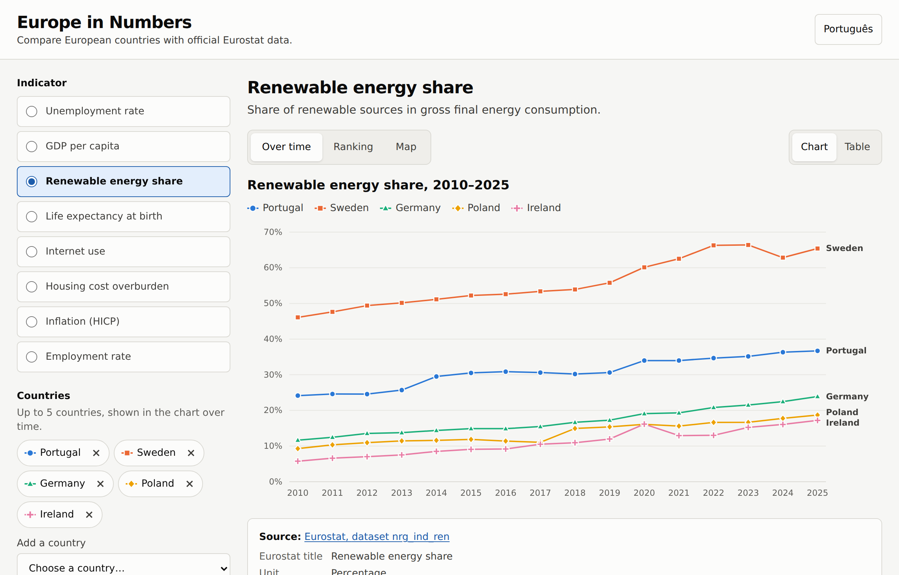
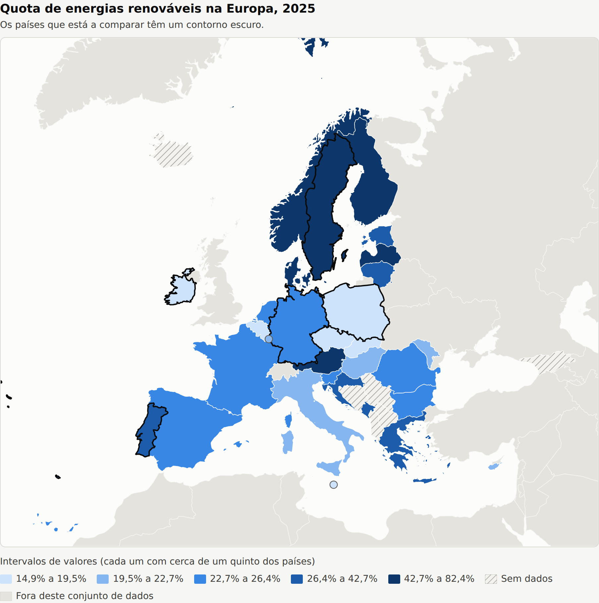

# Europe in Numbers

Compare European countries on eight official Eurostat indicators, in English or Portuguese. Every view is a shareable link.

**Live: [eurostat-viewer.vercel.app](https://eurostat-viewer.vercel.app/)** · [](https://github.com/suforozinho/eurostat-viewer/actions/workflows/ci.yml)



## What it does

- Eight curated indicators: unemployment, GDP per capita, renewable energy share, life expectancy, internet use, housing cost overburden, inflation (HICP) and employment rate.
- Compare up to five countries over time (line chart), or all countries for one year (ranked bars or a choropleth map).
- Full English and Portuguese interface, with locale-aware numbers ("6.4%" / "6,4%", "€38,650" / "38 650 €") and country names in European Portuguese.
- The URL holds the whole view (language, indicator, countries, years, tab, chart or table), so reload, back button and shared links all work.
- Keyboard and screen-reader friendly. Every chart has a table view, the palette is checked for colour blindness, and series are also told apart by marker shape and direct labels. No axe violations in light or dark mode.



## Stack

| Choice                                    | Why                                                                                                                                                           |
| ----------------------------------------- | ------------------------------------------------------------------------------------------------------------------------------------------------------------- |
| Next.js 16 (App Router, Cache Components) | Static shell per language served from the CDN, a server route to fetch and cache Eurostat, and `use cache` for the caching policy.                            |
| TypeScript, strict                        | The data has a lot of shapes (raw JSON-stat, clean payload, chart rows), and types keep them apart.                                                           |
| Own JSON-stat parser + Zod                | The parser is about 150 lines and fully tested against real responses. Zod turns an API change into a clear "unexpected format" message, not a broken chart.  |
| TanStack Query                            | Loading, error, retry and caching states without hand-written plumbing.                                                                                       |
| Hand-built SVG charts + `d3-scale`        | See [Decisions](#decisions-and-trade-offs): Recharts was in the plan and was replaced after measuring.                                                        |
| d3-geo, at build time                     | The map is projected once by a script, and the browser only gets SVG paths.                                                                                   |
| next-intl                                 | Messages, ICU plurals and the locale from the `[locale]` route via `next/root-params`.                                                                        |
| Vitest, Testing Library, Playwright, axe  | Unit tests for the parser and transforms, component tests for states and URL behaviour, end-to-end tests in a real browser, and accessibility checks in both. |
| GitHub Actions, Vercel                    | Lint, format, types, unit and e2e tests on every push.                                                                                                        |

## How it works

The browser loads a static page for `/en` or `/pt` from the CDN. The explorer reads the view from the URL and asks our own route, `GET /api/series?indicator=unemployment`, for data. That route accepts only the eight catalog ids, so it can't be used as an open proxy. It calls Eurostat's Statistics API with every dimension pinned to one value (unit, sex, age and so on), `geoLevel=country` and `sinceTimePeriod=2000`. That is about 1,000 cells per request, far below Eurostat's 500,000-cell limit.

The response is validated with Zod, parsed from JSON-stat into `{ country, year, value, flag }` rows, filtered to an allow-list of European countries, and validated again in its clean shape. A `use cache` function keeps good answers for 6 hours, refreshes them in the background, and never serves anything older than 12 hours. Eurostat updates twice a day, so that is fresh enough. Errors are cached for about a minute, so a Eurostat outage doesn't turn into a flood of retries. Requests to Eurostat go through a one-at-a-time queue, as its fair-use policy asks, and identical requests share one call. The route also sends `Cache-Control: s-maxage=21600, stale-while-revalidate`, so Vercel's CDN absorbs most traffic.

Because one response holds every country and year for an indicator, changing countries, years or tabs never makes another request.

```
browser ──► /en (static, CDN) ──► /api/series?indicator=… ──► use cache (6–12 h) ──► queue ──► Eurostat
              URL = state           validates id, maps errors     Zod + JSON-stat parser
```

## Decisions and trade-offs

- **One request per indicator, all countries.** `geoLevel=country` can't be combined with `geo`, and the full panel is tiny. So the app fetches everything once and filters in the browser. The 5-country cap is for readability, not for API limits.
- **Recharts was replaced with ~300 lines of SVG.** With Recharts, Lighthouse mobile performance was 78–82: its redux/immer runtime and synchronous renders added about 450 ms of main-thread blocking. Without it, the score is 90–92, and the charts gained arrow-key navigation with screen-reader announcements. The geometry (paths with gaps, ticks, rounded bars, non-overlapping end labels) is in small, tested functions.
- **Map projected at build time.** `scripts/build-map.ts` projects Natural Earth 1:50m boundaries with Lambert azimuthal equal-area centred on 10°E 52°N (the same as EPSG:3035, which Eurostat uses), clips them to the frame and writes SVG path strings. The map chunk loads only when the Map tab opens. Very small countries (Malta, Luxembourg, Liechtenstein, San Marino) also get a dot.
- **Missing data is shown, not hidden.** Gaps in lines stay gaps, and every point has a marker. On the map, "no value this year" (hatched) and "not covered by this dataset" (grey) look different. The default year for the ranking and map is the latest one that at least 80% of countries have reported, not the latest year a few countries published early. Eurostat flags (provisional, estimated, break in series…) appear in tooltips and tables.
- **The URL is the state.** Changes use the native History API, which Next.js syncs with `useSearchParams`, so there's no server round trip. One subtle bug is handled: a click in the first milliseconds after load, before Next's router is ready, is shown immediately and written once the router is listening.
- **Portuguese.** Eurostat answers only in English, French or German. Interface text and indicator names are translated by hand (European Portuguese), country names come from the browser's `Intl.DisplayNames('pt-PT')`, and a test fails if any key is missing or untranslated. **Eurostat's own dataset titles and unit labels stay in English**, marked with `lang="en"` and explained in the UI.
- **Things Eurostat does differently from the docs.** Queries with no results or invalid filter values return HTTP 200 with an empty dataset, not a 400. The parser treats any zero-sized dimension as "no data". `prc_hicp_aind` (inflation) was discontinued in 2026, so the app uses its replacement, `prc_hicp_ainr`. And right after a release, the first request for a dataset can take about 45 seconds, compared with 1 to 3 seconds normally. So the route waits up to 55 seconds (`maxDuration = 60`), and after 8 seconds the loading state tells the user that Eurostat is slow.
- **Left out on purpose:** accounts, saved dashboards, a database, any Eurostat dataset beyond the eight, forecasting, and a manual dark-mode toggle (dark mode follows the system setting).

## Quality

- 193 unit and component tests (Vitest + Testing Library + axe-core), including every saved Eurostat fixture, empty and malformed responses, all error codes, URL parsing and translation parity.
- Playwright: the main journey (pick an indicator, add two countries, switch language, reload from the URL), back button, lazy map, keyboard-only use, and axe scans with colour contrast for five views in light and dark mode. The e2e server runs with `EUROSTAT_FIXTURES=1`, so it answers from `fixtures/` and CI never calls Eurostat.
- Lighthouse 12 on the [deployed site](https://eurostat-viewer.vercel.app/en?indicator=unemployment&countries=PT,ES,DE), three runs each (24 Nov 2026):

  |         | Performance | Accessibility | Best practices | SEO |
  | ------- | ----------- | ------------- | -------------- | --- |
  | Desktop | 100         | 100           | 100            | 100 |
  | Mobile  | 90–92       | 100           | 100            | 100 |

  Mobile uses Lighthouse's simulated slow 4G and 4× CPU slowdown. The remaining cost is React hydration (about 350 ms of blocking time); layout shift is 0.

## What I would do next

- With 10,000 users: move the cache to a shared store (`use cache: remote` or Vercel Data Cache) so every serverless instance shares it, and pre-warm the eight indicators after each Eurostat release (11:00 and 23:00 CET) with a cron job.
- Show EU-27 averages as a reference line (a second, aggregate request).
- Click a country on the map to add it to the comparison, with a keyboard-accessible equivalent.
- Server-render the first chart for the default view, to cut mobile blocking time further.

## Data credit

Source: **Eurostat** ([copyright notice and free re-use of data](https://ec.europa.eu/eurostat/help/copyright-notice)). Datasets: `une_rt_a`, `nama_10_pc`, `nrg_ind_ren`, `demo_mlexpec`, `isoc_ci_ifp_iu`, `ilc_lvho07a`, `prc_hicp_ainr`, `lfsi_emp_a`. Changes: each dataset is filtered to one series per country, values are reformatted, and on the map grouped into ranges. Eurostat is not responsible for this site. Map boundaries: [Natural Earth](https://www.naturalearthdata.com/) (public domain), via [world-atlas](https://github.com/topojson/world-atlas). The Kosovo designation footnote required by Eurostat is shown in the footer.

## Run it locally

```bash
npm install
npm run dev        # http://localhost:3000
npm test           # unit and component tests
```

Other scripts: `npm run test:e2e` (Playwright; run `npx playwright install chromium` first), `npm run typecheck`, `npm run lint`, `npm run fixtures` (refresh the saved Eurostat responses), `npm run build:map` (rebuild the map geometry).

The `dev` and `start` scripts set `--dns-result-order=ipv4first`, because on some networks (WSL2, for one) Node tries Eurostat's IPv6 address first and fails. Optional settings are listed in `.env.example`.
